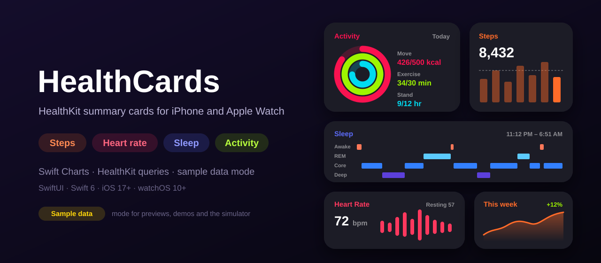
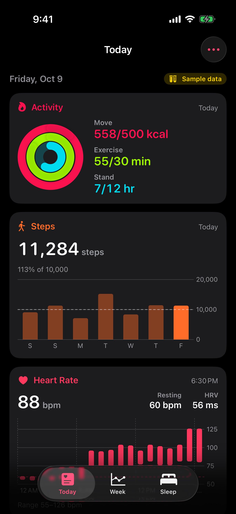
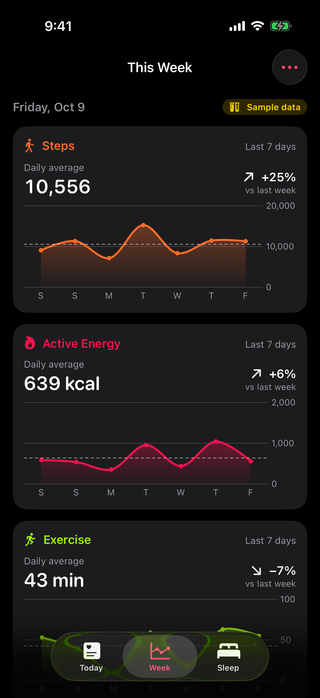
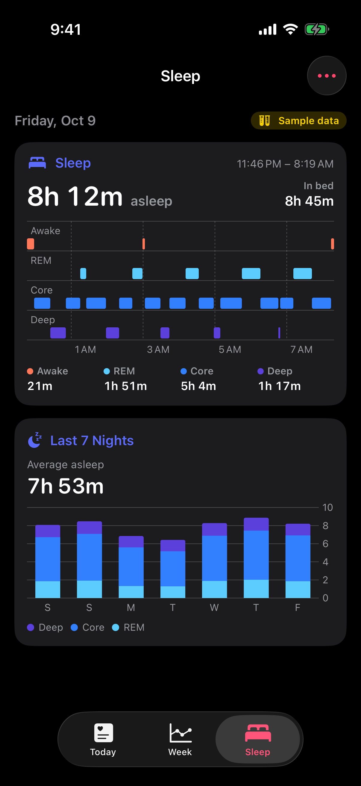
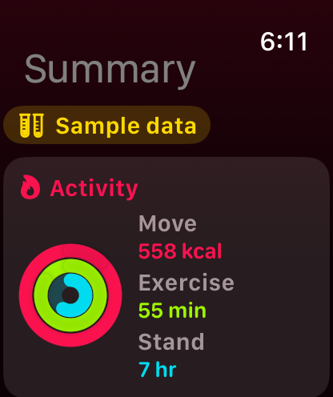
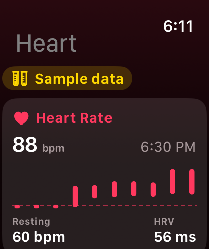

<p align="center">
  
</p>

<p align="center">
  <a href="https://github.com/halilozel1903/HealthCards/actions/workflows/ci.yml"></a>
  
  
  
  
  
  
  <a href="LICENSE"></a>
</p>

**HealthCards** gives your iPhone and Apple Watch app HealthKit summary cards: **steps**, **heart rate**, **sleep stages** and **activity rings**, plus weekly trends and workouts, drawn with **Swift Charts**. A small data layer does the HealthKit work (authorization, statistics collections, sleep and heart rate queries) behind a `HealthDataSource` protocol, and a **sample data mode** generates deterministic, plausible data for SwiftUI previews, demos and the simulator, which has no health data. Values are formatted with `Measurement` and Foundation's format styles, so they follow the user's locale. No dependencies.

```swift
import HealthCards
import HealthCardsUI

let health: any HealthDataSource = HealthKitDataSource()     // or SampleHealthDataSource()
try await health.requestAuthorization()
let today = try await health.snapshot()                      // every query runs in parallel

ActivityRingsCard(rings: today.rings)
StepsCard(steps: today.steps, week: today.stepsTrend.days)
HeartRateCard(summary: today.heartRate)
SleepCard(night: today.lastNight)
WeeklyTrendCard(trend: today.energyTrend)
```

## Screenshots

Captured by CI from the example app, *Vitals*, on an iPhone and an Apple Watch simulator.

| iPhone: today | iPhone: week | iPhone: sleep |
| :---: | :---: | :---: |
|  |  |  |

| Watch: summary | Watch: heart rate |
| :---: | :---: |
|  |  |

> **These screenshots show the built-in sample data mode, not real health data.** Simulators have no HealthKit data, so the screenshot scenes use `SampleHealthDataSource` with a fixed date (Friday 9 October 2026, 18:30). The app shows a small **Sample data** label whenever it displays sample data. On a device with Health data, the same cards show your own numbers.

## Features

- **One protocol, two sources**: `HealthDataSource` describes what the cards need. `HealthKitDataSource` reads HealthKit; `SampleHealthDataSource` generates data; write your own for a server or fixtures. `isSampleData` tells the UI which one it has.
- **HealthKit queries done for you**: statistics collections (`HKStatisticsCollectionQueryDescriptor`) for steps, active energy, exercise minutes, distance, heart rate, resting heart rate and HRV, by day or by week; heart rate samples; sleep stages; activity summaries with your goals; workouts with energy and distance. Read only: HealthCards never asks to write.
- **Authorization helper**: `requestAuthorization()` asks for exactly the types the source reads (HRV is optional), `authorizationStatus()` tells you whether the sheet would still appear, and `HealthDataError.healthDataUnavailable` covers devices without Health.
- **Sample data mode**: steps with weekday and weekend patterns, workouts on most days, heart rate every five minutes with a daily rhythm and workout peaks, and nights of four or five sleep cycles with more deep sleep early and more REM towards morning. Each day comes from the seed and the calendar date only, so the same day always looks the same, in any range and on any OS version. Today fills in up to `now`.
- **Careful aggregation**: `HealthAggregation` buckets points into days and weeks (sums count empty days as zero, averages leave them out), re-buckets daily data into weeks, compares this week with the last, and measures sleep from the union of segments so overlapping sources never count twice. `SleepNight` merges duplicate segments and prefers staged sleep over plain "asleep".
- **Cards built with Swift Charts**: `StepsCard` (week bars and a goal line), `HeartRateCard` (hourly range capsules and a resting line), `SleepCard` (stage bars on a timeline, Awake to Deep), `SleepHistoryCard` (stacked nights), `ActivityRingsCard`, `WeeklyTrendCard` (line, area and average) and `WorkoutsCard`. Each handles missing data with a short message.
- **Compact Apple Watch variants**: `CompactActivityRingsCard`, `CompactStepsCard`, `CompactHeartRateCard` and `CompactSleepCard`, with small charts and no axes.
- **Locale aware**: `HealthFormatter` uses `Measurement` and format styles: "8,432" or "8.432" steps, kilometers or miles by region, "412 kcal", "48 ms", "7h 21m", times and weekdays in the calendar's time zone. The cards read the environment's locale and calendar.
- **Swift 6 strict concurrency**: every model is a `Sendable` value type, data sources are `Sendable`, and `snapshot(for:)` runs its queries with `async let` and a task group.
- **Tested**: Swift Testing suites for aggregation, sleep and heart rate models, sample data determinism and plausibility, and formatting in several locales, on macOS, iOS and watchOS.

## API

| Type | What it does |
| --- | --- |
| `HealthDataSource` | `statistics(_:in:bucket:)`, `heartRate(on:)`, `sleep(forNightEndingOn:)`, `activityRings(on:)`, `workouts(in:)`, `requestAuthorization()`, `authorizationStatus()`; extensions `snapshot(for:)`, `dailyStatistics(_:days:endingOn:)`, `weeklyStatistics(_:weeks:endingOn:)`, `weeklyTrend(_:endingOn:)`, `recentNights(endingOn:count:)`, `isSampleData` |
| `HealthKitDataSource` | The HealthKit implementation (iOS and watchOS). `isAvailable`, `readTypes`, `readsHeartRateVariability` |
| `SampleHealthDataSource` | Deterministic sample data. `init(seed:calendar:now:goals:)`, `preview`, `showcaseDate(calendar:)`, and synchronous `points`, `heartRateSummary(on:)`, `night(endingOn:)`, `rings(on:)`, `workoutList(in:)`, `makeSnapshot(for:)` for previews |
| `makeDefaultHealthDataSource()` | HealthKit when the device has it, sample data otherwise |
| `HealthMetric` | `steps`, `activeEnergy`, `exerciseTime`, `walkingRunningDistance`, `heartRate`, `restingHeartRate`, `heartRateVariability`, each with its `aggregation`, `title` and `symbolName` |
| `MetricPoint`, `StatisticsBucket` | A value for a day or week; `.day` or `.week` buckets |
| `HealthSnapshot` | Today's steps, energy, exercise, distance, rings, heart rate, last night, the last seven nights, three weekly trends and the week's workouts |
| `WeeklyTrend` | Seven days against the seven before: `total`, `average`, `change`, `best`, `latest` |
| `HeartRateSummary` | Samples, `resting`, `variability`, `latest`, `minimum`, `maximum`, `average`, `ranges(hours:calendar:)` |
| `SleepNight`, `SleepSegment`, `SleepStage` | Stages, `asleepDuration`, `timeInBed`, `duration(of:)`, `stageDurations`; `SleepStage(healthKitValue:)` |
| `ActivityRings`, `RingValue`, `ActivityGoals` | Move, exercise and stand with their goals and `progress` |
| `Workout`, `WorkoutActivity` | Activity, start, end, `duration`, `activeEnergy`, `distance`; titles and SF Symbols |
| `HealthAggregation` | `bucketStarts`, `normalize`, `weekly`, `total`, `mean`, `change`, `unionDuration`, `sleepWindow` |
| `HealthFormatter` | `steps`, `energy(kilocalories:)`, `minutes`, `hours`, `distance(meters:)`, `heartRate`, `variability(milliseconds:)`, `duration`, `percent`, `change`, `value(_:for:)`, `weekday`, `time`, `day` |
| `HealthCardsUI` | `StepsCard`, `HeartRateCard`, `SleepCard`, `SleepHistoryCard`, `ActivityRingsCard`, `ActivityRingsView`, `WeeklyTrendCard`, `WorkoutsCard`, the `Compact…Card` views, `HealthCard`, `CompactHealthCard`, `SampleDataBadge`, `HealthPalette` |

## Installation

In Xcode choose **File › Add Package Dependencies…** and enter:

```
https://github.com/halilozel1903/HealthCards
```

Or add it to `Package.swift`:

```swift
dependencies: [
    .package(url: "https://github.com/halilozel1903/HealthCards", from: "1.0.0")
],
targets: [
    .target(name: "MyApp", dependencies: [
        .product(name: "HealthCards", package: "HealthCards"),
        .product(name: "HealthCardsUI", package: "HealthCards"),   // the SwiftUI cards
    ])
]
```

### HealthKit setup

To read real data, your app (the iPhone app and, for a standalone or independent watch app, the watch app) needs:

1. The **HealthKit** capability (*Signing & Capabilities › + Capability › HealthKit*), which adds the `com.apple.developer.healthkit` entitlement.
2. An `NSHealthShareUsageDescription` in its Info.plist that says why you read health data. HealthCards never writes, but add an `NSHealthUpdateUsageDescription` too if any part of your app does.

The sample data mode needs neither.

## Usage

### Ask for access and load a day

```swift
let health = HealthKitDataSource(readsHeartRateVariability: true)

if try await health.authorizationStatus() == .shouldRequest {
    try await health.requestAuthorization()     // shows the Health permission sheet
}

let today = try await health.snapshot()        // HealthSnapshot for the current day
today.steps                                    // 8432.0
today.stepsTrend.change                        // 0.12, 12% more than last week
today.lastNight?.asleepDuration                // 26_460 seconds
today.rings?.move.progress                     // 0.85
```

HealthKit never says whether reading was denied: denied types read as empty, and the cards show "No data" messages.

### Statistics collections

```swift
let interval = DateInterval(start: monthStart, end: .now)
let daily = try await health.statistics(.steps, in: interval, bucket: .day)        // [MetricPoint], zero-filled
let weekly = try await health.statistics(.restingHeartRate, in: interval, bucket: .week)  // weekly averages

let lastTwoWeeks = try await health.dailyStatistics(.activeEnergy, days: 14, endingOn: .now)
let trend = try await health.weeklyTrend(.exerciseTime, endingOn: .now)
trend.average                                   // minutes per day this week
trend.previousAverage                           // minutes per day the week before
```

### Heart rate, sleep, rings and workouts

```swift
let heart = try await health.heartRate(on: .now)
heart.latest?.beatsPerMinute                    // 72
heart.resting                                   // 57
heart.variability                               // 48, in milliseconds
heart.ranges(hours: 1)                          // [HeartRateRange] for a range chart

if let night = try await health.sleep(forNightEndingOn: .now) {
    night.duration(of: .deep)                   // seconds of deep sleep
    night.stageDurations                        // Awake, REM, Core, Deep
}

let rings = try await health.activityRings(on: .now)
let workouts = try await health.workouts(in: DateInterval(start: weekAgo, end: .now))
```

### Sample data mode

```swift
let sample = SampleHealthDataSource()                         // ends at the current time
let fixed = SampleHealthDataSource(seed: 7, now: someDate)    // repeatable, for tests and screenshots
sample.isSampleData                                           // true: show it in your UI

let snapshot = try await sample.snapshot()                    // same API as HealthKit
```

Show users when they look at sample data. `SampleDataBadge()` is a small "Sample data" label for that.

### Cards

```swift
ScrollView {
    VStack(spacing: 14) {
        if health.isSampleData {
            SampleDataBadge()
        }
        ActivityRingsCard(rings: today.rings)
        StepsCard(steps: today.steps, week: today.stepsTrend.days, goal: 10_000)
        HeartRateCard(summary: today.heartRate, hoursPerBar: 1)
        SleepCard(night: today.lastNight)
        SleepHistoryCard(nights: today.recentNights)
        WeeklyTrendCard(trend: today.stepsTrend)
        WorkoutsCard(workouts: today.workouts, limit: 3)
    }
    .padding()
}
```

On Apple Watch, use the compact variants:

```swift
CompactActivityRingsCard(rings: today.rings)
CompactStepsCard(steps: today.steps, week: today.stepsTrend.days)
CompactHeartRateCard(summary: today.heartRate)
CompactSleepCard(night: today.lastNight)
```

Previews need no HealthKit and no `async`:

```swift
#Preview {
    let today = SampleHealthDataSource.preview.makeSnapshot()
    return SleepCard(night: today.lastNight).padding()
}
```

Build your own cards in the same frame with `HealthCard("Title", systemImage:tint:caption:) { … }`, and reuse `HealthPalette` and `HealthFormatter`.

### Formatting

```swift
let format = HealthFormatter(locale: Locale(identifier: "de_DE"))
format.steps(8432)                          // "8.432"
format.distance(meters: 5_000)              // "5 km" ("3.1 mi" for en_US)
format.energy(kilocalories: 412)            // "412 kcal"
format.change(0.12)                         // "+12 %"
format.value(57, for: .restingHeartRate)    // "57 bpm"
```

## Example apps

The `Example` folder contains *Vitals*, built with HealthCards and HealthCardsUI:

- **iPhone**: *Today* with the rings, steps and heart rate; *This Week* with trends for steps, active energy and exercise and the latest workouts; *Sleep* with last night's stages and the last seven nights. The menu switches between Health data and sample data.
- **Apple Watch**: vertical pages for the summary (rings and steps), heart rate and sleep.

The project uses [XcodeGen](https://github.com/yonaskolb/XcodeGen), so no project file has to live in the repo:

```bash
brew install xcodegen
cd Example && xcodegen generate
open HealthCardsDemo.xcodeproj
```

Run `VitalsPhone` on an iPhone and `VitalsWatch` on an Apple Watch. In the simulator the app starts in sample data mode; on a device it asks for Health access. Launch with `-screenshot today|week|sleep` (iPhone) or `-screenshot summary|heart` (Apple Watch) to open one scene with sample data and a fixed date, as CI does for the screenshots above. To run on a device, set your development team; the targets already have the HealthKit entitlement and usage strings.

## Requirements

- Xcode 26 or later (Swift 6.2 toolchain)
- iOS 17+, watchOS 10+ (macOS 14+ only to run the tests; the HealthKit source is built for iOS and watchOS)

## Contributing

Issues and pull requests are welcome. Please run the tests before opening a PR:

```bash
swift test
bash scripts/test.sh iOS
bash scripts/test.sh watchOS
```

## License

HealthCards is available under the MIT license. See [LICENSE](LICENSE). HealthCards is not affiliated with Apple. HealthKit, Apple Watch and iPhone are trademarks of Apple Inc.
